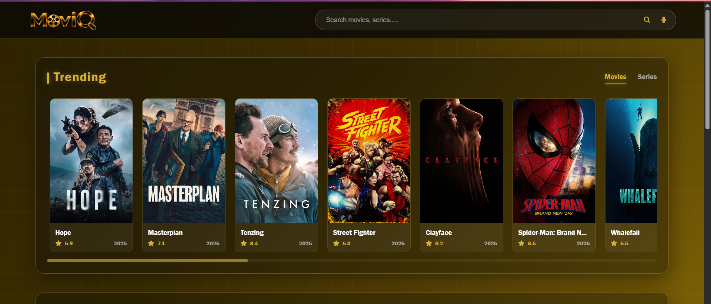
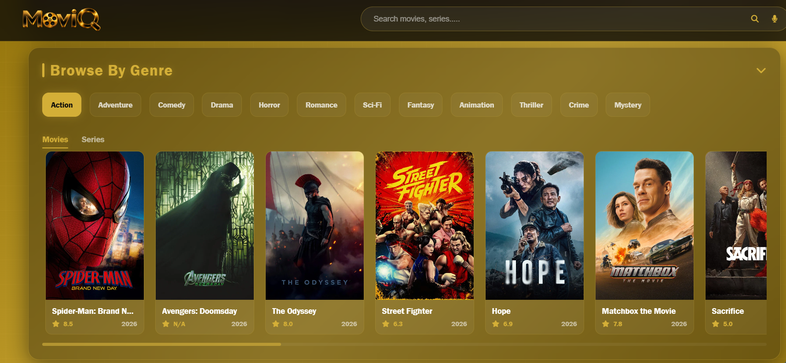
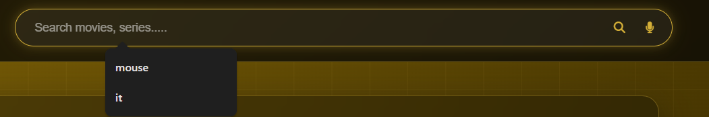
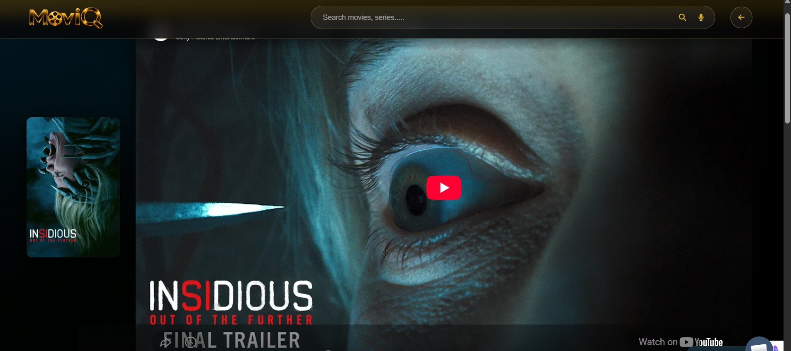

# 🎬 MoviQ

MoviQ is a movie and TV series discovery website. Browse trending, top-rated
and popular titles, filter by genre, search by text or voice, and open a details
page with the trailer, cast, similar titles and streaming platforms available in India.

**Live demo:** https://moviq-in.netlify.app/
**Repository:** https://github.com/shreyakushwaha39/MoviQ

## Features
- Trending, Top Rated and Popular sections with Movies / Series tabs
- Genre filter for movies and series
- Search for movies and series, with voice search (browser speech recognition)
- Details page with poster, backdrop, rating, release date, runtime, language,
  genres and overview
- Official YouTube trailer embedded on the details page
- Top 10 cast members and similar titles
- Streaming platforms in India (subscription, rent, buy, free) with watch links
- Splash screen, loading states and error messages

## Tech stack
| Layer | Technology |
|---|---|
| Frontend | HTML, CSS, vanilla JavaScript |
| Movie data | TMDB API |
| Streaming data | Watchmode API |
| Backend proxy | Netlify Functions (Node.js) |
| Hosting | Netlify, with source code on GitHub |

## How the API keys stay secret
API keys placed in front-end JavaScript can be read by anyone through the browser,
so MoviQ never puts them there. Instead, the browser calls its own server routes,
and a serverless function adds the key on the server side.

```
Browser (no keys) -> /api/tmdb/...      -> Netlify Function (key from environment) -> TMDB
Browser (no keys) -> /api/watchmode/... -> Netlify Function (key from environment) -> Watchmode
```

- Keys are stored only in Netlify environment variables (and a local `.env` file
  that is listed in `.gitignore`).
- The functions only accept a short list of allowed endpoints, so they cannot be
  used as an open proxy.
- Responses are cached briefly to save API quota.

## Project structure
```
MoviQ/
├── netlify/
│   └── functions/
│       ├── tmdb.mjs          # TMDB proxy
│       └── watchmode.mjs     # Watchmode proxy
├── public/
│   ├── index.html
│   ├── movie-details.html
│   ├── index.js              # all front-end logic
│   ├── style.css
│   └── images/
├── netlify.toml              # publish folder and functions folder
├── server.js                 # local development server (same proxy routes)
├── .env.example              # variable names with fake values
└── README.md
```

## Run locally
1. Install [Node.js](https://nodejs.org) (version 18 or newer) and clone the repository:
```bash
   git clone https://github.com/shreyakushwaha39/MoviQ.git
   cd MoviQ
   npm install
```
2. Get free API keys:
   - TMDB: https://www.themoviedb.org/settings/api (use the **API Key (v3)**)
   - Watchmode: https://api.watchmode.com (select India as a country)
3. Create a file named `.env` in the project root, with each variable on its own line:
```
   TMDB_API_KEY=your-tmdb-key
   WATCHMODE_API_KEY=your-watchmode-key
   PORT=3001
```
4. Start the server and open http://localhost:3001
```bash
   node server.js
```

## Deploy to Netlify
1. Push the repository to GitHub (`.env` is ignored and is never uploaded).
2. On Netlify choose **Add new site -> Import an existing project -> GitHub**
   and select this repository.
3. Settings are read from `netlify.toml`
   (publish directory `public`, functions directory `netlify/functions`).
4. Under **Site configuration -> Environment variables** add:

   | Key | Value |
   |---|---|
   | `TMDB_API_KEY` | your TMDB key |
   | `WATCHMODE_API_KEY` | your Watchmode key |

5. Deploy. Every `git push` to `main` redeploys the site automatically.

## API routes
| Route | Forwards to | Purpose |
|---|---|---|
| `GET /api/tmdb/*` | TMDB v3 API | Movie and series lists, details, cast, videos, search |
| `GET /api/watchmode/title/{type}-{id}/sources` | Watchmode API | Streaming platforms in India |

## Screenshots
| | |
|---|---|
| Home page |  |
| Genre filter |  |
| Search results |  |
| Details page with trailer |  |
| Cast and streaming platforms |  |

## Credits
- Movie and series data from [TMDB](https://www.themoviedb.org). This product uses the
  TMDB API but is not endorsed or certified by TMDB.
- Streaming availability from [Watchmode](https://api.watchmode.com).
